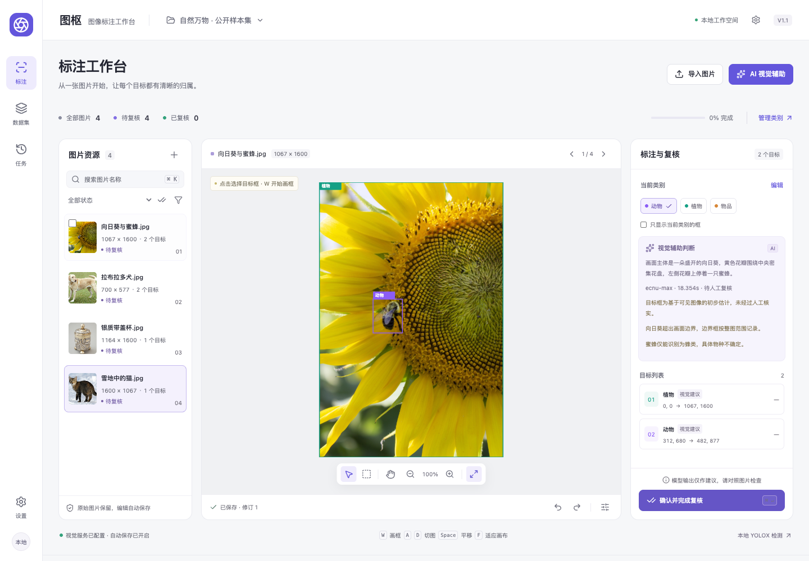

# 图枢图像批量处理与智能辅助标注软件 V1.1

本地图像整理与矩形检测标注工作台。提供网页界面，支持图片导入、几何/编码处理、本地 YOLOX 预标注、可选视觉大模型辅助、人工校正复核、同源组划分及 YOLO/COCO 数据集导出。



## 本机运行

当前开发和验证平台为 macOS Apple Silicon。网页服务只监听 `127.0.0.1`，使用本机浏览器；没有登录、云端项目存储或内置训练服务。

```sh
uv venv --python 3.11 .venv
uv pip sync --python .venv/bin/python requirements-runtime.lock.txt
uv pip install --python .venv/bin/python --no-deps -e .
.venv/bin/python scripts/download_model.py  # 仅安装时显式下载并校验官方模型
.venv/bin/python -m tushu.web.launcher
```

本仓库包含已构建的网页静态资源。修改前端后重新构建：

```sh
npm --prefix frontend ci
npm --prefix frontend run build
```

本地交付目录另附 `启动图枢网页.command` 和 arm64 应用包；公开仓库不包含用户虚拟环境、项目数据库或第三方大模型权重。

## 使用流程

新建项目后可使用动物、植物、物品三类，或添加更细类别。导入 JPEG/PNG/静态 WebP 图片；原图复制成项目快照，处理结果另存版本。手工画框或运行辅助预标注，逐图检查后完成复核。质量检查通过、同源组划分有效时，可以导出 YOLO 或 COCO。导出先写临时目录，独立回读成功后才发布；负样本保留。

快捷键：W 画框，Esc 返回选择，A/D 切图，Space 拖动平移，F 适应画布，Delete 删除明确选中的框，Ctrl/⌘ Z 撤销，Ctrl/⌘ Shift Z 重做，Ctrl/⌘ Enter 完成复核。文本输入时不会误触画布删除。

## 自行准备视觉模型 API

**公开代码不含可用 API Key。需要视觉辅助时，请自行准备具有图片理解能力的 OpenAI 兼容 API。** 可以在网页设置中输入 Base URL、模型名和密钥，也可通过环境变量设置：

```sh
export TUSHU_VISION_BASE_URL='https://你的视觉服务/v1'
export TUSHU_VISION_MODEL='你的视觉模型名'
export TUSHU_VISION_API_KEY='填写你自己的密钥'
.venv/bin/python -m tushu.web.launcher
```

`.env.example` 只提供空白配置参考，不自动读取。网页输入的密钥保存在本次服务内存，不返回网页、不写入数据库、导出或材料。发送前显示图片范围和服务域名，必须明确确认。图片缩小到最长边不超过 1600 再发送，返回内容经过类别和坐标校验。视觉输出均为待复核建议，不自动确认正确性或负样本，也不等于专业物种鉴定。

本地 YOLOX 只识别所选 COCO 模型既有类别；“盆栽”不代表任意植物或植物物种。视觉辅助可以提出更广的候选，但仍需逐图核对。没有 API 也可使用人工标注、本地检测、批处理、检查和导出。

## 源码与验证

- `frontend/src`：实际网页、标注交互、状态和接口封装。
- `src/tushu/services/vision.py`：视觉请求、JSON 校验、全分辨率坐标转换和人工结果保护。
- `src/tushu/web`：本机 API、后台任务、项目/标注/数据集操作与静态页面服务。
- `src/tushu/imaging`、`services`、`datasets`、`validation`：图像/框同步、版本、分组和独立回读。
- `samples/public`：四张有来源和许可记录的公开功能样例，见 [署名与许可](samples/public/ATTRIBUTION.md)。
- `docs/vision-validation-summary.json`：真实 ecnu-max 调用结果摘要；不包含凭据或用户原始路径。

```sh
uv pip install --python .venv/bin/python -e '.[dev]'
QT_QPA_PLATFORM=offscreen .venv/bin/pytest -q tests
.venv/bin/ruff check src
```

V1.1 测试包括 33 项 Python 测试、前端编译、浏览器真实画框/保存/撤销和零筛选保护；V1.0 基线另做过 500 张合成工程图片导入、真实 YOLOX 推理、双格式导出和 Torchvision 数据加载。四张公开照片均完成真实视觉调用并保存候选。这些是功能和工程验证，不能当作识别精确率/召回率报告。

## 许可与边界

业务源码当前公开供查看，未指定开放源码授权许可。第三方库、YOLOX 代码/权重和公开图片各自遵循原许可，见 `licenses/`、`models/yolox-s-coco/SOURCE.md` 和图片署名文件。公开发布前须自行核实第三方权重的再分发条件；本仓库只提供显式下载脚本与摘要，不重新分发权重。

不含私密项目、API Key、个人证件/软著登记信息。公开样例及截图中的 CC BY-SA 图片按相应原许可单独提供，不随业务源码的授权口径改变。

当前是单机辅助工具；不承诺任意目标、植物物种或遮挡小目标的准确识别。不支持分割、关键点、视频、云协作或内置训练。登记材料和第三方测试结论须根据真实资料单独确认。
